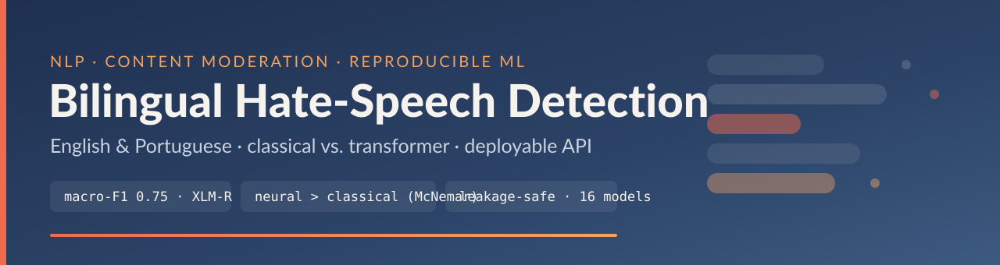
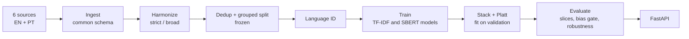

<div align="center">



# Bilingual Hate-Speech Detection (EN / PT)

**Binary hate-speech classification for English and Portuguese social-media text, with the
reproducible pipeline behind the Luciola site and API.**

[](https://github.com/isasaade-23/hate-speech-nlp-en-pt/actions/workflows/ci.yml)
[](https://isasaade-23.github.io/hate-speech-nlp-en-pt/)
[](https://luciola.65-108-90-215.sslip.io)


[Português](README.pt-BR.md) ·
**[Live site](https://luciola.65-108-90-215.sslip.io)** ·
**[Documentation](https://isasaade-23.github.io/hate-speech-nlp-en-pt/)**

</div>

## What this repository does

It builds one text-only classifier for English and Portuguese, from the public datasets to the
model served by the site and the API. Every number in this README comes from a file in
`reports/` produced by the code here. Site code lives in
[hate-speech-demo](https://github.com/isasaade-23/hate-speech-demo) and the browser extension in
[luciola-extension](https://github.com/isasaade-23/luciola-extension).

## Served model and result

The served model is a stacked ensemble (stack v5). A meta logistic regression combines three
TF-IDF models (logistic regression, linear SVM, LightGBM). The meta model, the decision threshold
and the Platt calibration are fit on the validation split only.

On the frozen v5 test (16,261 rows, strict label policy):

| Model | ROC-AUC | macro-F1 | Recall on hate |
|---|---|---|---|
| **Stacked ensemble (served)** | **0.8875** | **0.7906** | **0.7359** |
| tfidf_logreg | 0.884 | 0.788 | 0.707 |
| tfidf_lgbm | 0.870 | 0.773 | 0.715 |
| tfidf_svm | 0.855 | 0.768 | 0.679 |

The average hides the language gap. Recall on hate is 0.776 in English (n=11,513) and 0.316 in
Portuguese (n=4,748), in `reports/tables/stack_slices_v5_strict.csv`. The three permissively
licensed sources are all English, and the Portuguese sources are smaller and carry restrictive
or unclear licenses.

## Data

Corpus v5 (strict) has 113,826 rows from six sources, 28.8% labelled hate. Two more sources
(MultiOFF, Memotion) are kept only as external tests. Licenses and origin are in
[`data/MANIFEST.csv`](data/MANIFEST.csv) and
[`methodology/data_provenance.md`](methodology/data_provenance.md).

| Source | Language | Rows in corpus v5 | How to get it |
|---|---|---|---|
| Vidgen et al. 2021 (adversarial) | EN | 41,097 | `scripts/download_data.py` |
| ToLD-BR | PT | 20,797 | `scripts/download_data.py` |
| tweets_ip | EN | 20,302 | not public, ask the maintainer |
| HateXplain | EN | 19,189 | `scripts/download_data.py` |
| HateBR | PT | 6,777 | `scripts/download_data.py` |
| Fortuna et al. 2019 | PT | 5,664 | `scripts/download_data.py` |

`download_data.py` fetches each file at a pinned commit and checks its sha256 against the copy
used in corpus v5. Two label policies are built and reported side by side. Strict marks only
explicit hate. Broad also marks offensive language. The mapping is in
[`methodology/label_mapping.md`](methodology/label_mapping.md).

## Pipeline



## Quickstart

```bash
python -m venv .venv && . .venv/Scripts/activate      # Linux/macOS: . .venv/bin/activate
pip install -r requirements.txt && pip install -e .

python scripts/download_data.py                       # 5 public sources -> data/source_zips/
hsc ingest && hsc probe-dataset2
hsc harmonize --policy strict && hsc split --policy strict && hsc langid --policy strict
hsc train -c configs/classical/tfidf_logreg.yaml --policy strict   # repeat for svm and lgbm
python scripts/build_stack.py --policy strict         # served stack -> models/stack_strict_s42/
hsc report
pytest -q                                             # leakage gate, metrics, API contract
```

The full order, including calibration and the evaluation scripts, is in
[`docs/reproducibility.md`](docs/reproducibility.md). Transformers train on Colab with
[`notebooks/colab_neural.ipynb`](notebooks/colab_neural.ipynb). The API runs with
`uvicorn api.main:app` (see [`docs/api.md`](docs/api.md)).

## Portuguese study (`scripts/`)

Each script answers one question about the Portuguese gap and writes a table to `reports/tables/`.

| Script | Question |
|---|---|
| `auditoria_pt.py` | Are there duplicates across splits, and does more PT data still help (learning curve)? |
| `llm_label.py` | Does an LLM judge agree with the original PT labels? |
| `hatebr_partidarismo.py` | How does HateBR's partyism code change the strict label? |
| `pt_gap.py` | Where does the stack lose recall in PT, without retraining? |
| `pt_boost.py` | Which levers raise PT recall without a GPU? |
| `pt_threshold_bias.py` | What does a PT-specific threshold cost in identity bias? |
| `pt_ensemble.py` | Does combining the stack with a PT-only model help on the PT slice? |
| `pt_identity_probe.py` | Does a model flag people who describe their own identity? |
| `bias_gate_v5.py` | Release gate, so no candidate raises identity over-flagging in PT. |
| `perturbation_robustness.py` | How do spelling obfuscation and identity terms move the score? |
| `commercial_retrain_compare.py` | What is left when training only on commercially licensed sources? |

Decisions and their dates are logged in
[`methodology/DECISOES_METODOLOGICAS.md`](methodology/DECISOES_METODOLOGICAS.md) (Portuguese).

## Open points for review

- PT recall on hate is 0.316 against 0.776 in English.
- twitter-XLM-R raised PT recall from 0.316 to 0.507 and lowered identity over-flagging from
  0.137 to 0.119 in the bias gate ([`methodology/pt_recall_x_vies.md`](methodology/pt_recall_x_vies.md)).
  It is not served because the checkpoint has 1.1 GB.
- Transformers were trained on the earlier corpus and were not retrained on corpus v5.
- Adding SBERT members to the stack gave +0.009 AUC on corpus v4. It was not rerun on v5.
- Already measured without gain, so not worth repeating: Bayesian hyperparameter search,
  per-language threshold, normalization ablation, frozen LFM2.5 encoder (AUC 0.670), stop-word
  removal, HurtLex lexicon features, `min_df=2`.

## Repository layout

```
configs/      data, label and model configs (the methodology as code)
src/hsc/      package and `hsc` CLI: ingest, harmonize, clean, splits, langid, features,
              models, train, evaluate, analysis, transfer, bias_probe, product, inference
scripts/      download, stack build, v5 evaluation and the Portuguese study
api/ deploy/  FastAPI service and Docker
notebooks/    Colab notebooks for the transformers
models/       model cards, metrics and registry (weights are regenerated, not committed)
reports/      metrics and tables produced by the code
methodology/  decision log, provenance, label mapping, limitations
tests/        leakage gate, metric and contract tests (pytest)
docs/         documentation site (mkdocs)
```

## Responsible use

This is a probabilistic research classifier and should support human review, not replace it.
It reflects the biases of its training data. A Portuguese-only variant over-flagged real
non-hateful identity sentences in 34.0% of cases against 13.7% for the served model, and was
blocked from release ([`methodology/pt_recall_x_vies.md`](methodology/pt_recall_x_vies.md)).

## License

**Code**: [GNU AGPL v3.0](LICENSE). Running a modified version as a network service requires
offering its source to the service's users (AGPL section 13).

**Trained model artifacts**: research and educational use only, no commercial use, because the
training-data licenses restrict what can be granted. See [`LICENSE-MODEL.md`](LICENSE-MODEL.md).

## Author

**Isabela Venancio da Silva**, PhD candidate in Public Health, University of São Paulo (FSP-USP),
LABDAPS. [ORCID](https://orcid.org/0000-0003-0156-7837) ·
[Lattes](http://lattes.cnpq.br/7006765766090773) ·
[Ko-fi](https://ko-fi.com/ailuciola)
