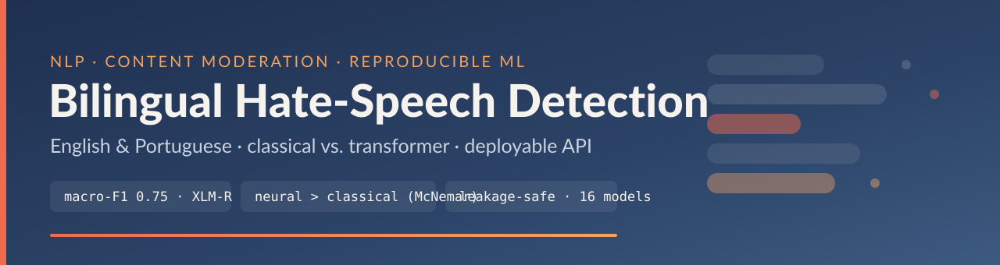
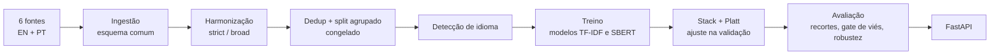

<div align="center">



# Detecção bilíngue de discurso de ódio (EN / PT)

**Classificação binária de discurso de ódio em textos de redes sociais em inglês e português, com
o pipeline reprodutível por trás do site e da API da Luciola.**

[English](README.md) ·
**[Site no ar](https://luciola.65-108-90-215.sslip.io)** ·
**[Documentação](https://isasaade-23.github.io/hate-speech-nlp-en-pt/)**

</div>

## O que este repositório faz

Ele constrói um classificador só de texto para inglês e português, das bases públicas até o
modelo servido pelo site e pela API. Todo número deste README vem de um arquivo em `reports/`
gerado pelo código daqui. O código do site está em
[hate-speech-demo](https://github.com/isasaade-23/hate-speech-demo) e a extensão de navegador em
[luciola-extension](https://github.com/isasaade-23/luciola-extension).

## Modelo servido e resultado

O modelo servido é um ensemble empilhado (stack v5). Uma regressão logística combina três modelos
TF-IDF (regressão logística, SVM linear e LightGBM). O metamodelo, o limiar de decisão e a
calibração de Platt são ajustados só no split de validação.

No teste congelado do v5 (16.261 linhas, política de rótulo strict):

| Modelo | ROC-AUC | macro-F1 | Recall de ódio |
|---|---|---|---|
| **Ensemble empilhado (servido)** | **0,8875** | **0,7906** | **0,7359** |
| tfidf_logreg | 0,884 | 0,788 | 0,707 |
| tfidf_lgbm | 0,870 | 0,773 | 0,715 |
| tfidf_svm | 0,855 | 0,768 | 0,679 |

A média esconde a diferença entre idiomas. O recall de ódio é 0,776 em inglês (n=11.513) e
0,316 em português (n=4.748), em `reports/tables/stack_slices_v5_strict.csv`. As três fontes com
licença permissiva são todas em inglês, e as fontes em português são menores e têm licença
restritiva ou indefinida.

## Dados

O corpus v5 (strict) tem 113.826 linhas de seis fontes, 28,8% rotuladas como ódio. Outras duas
fontes (MultiOFF e Memotion) ficam só como teste externo. Licenças e origem estão em
[`data/MANIFEST.csv`](data/MANIFEST.csv) e
[`methodology/data_provenance.md`](methodology/data_provenance.md).

| Fonte | Idioma | Linhas no corpus v5 | Como obter |
|---|---|---|---|
| Vidgen et al. 2021 (adversarial) | EN | 41.097 | `scripts/download_data.py` |
| ToLD-BR | PT | 20.797 | `scripts/download_data.py` |
| tweets_ip | EN | 20.302 | não é pública, pedir à mantenedora |
| HateXplain | EN | 19.189 | `scripts/download_data.py` |
| HateBR | PT | 6.777 | `scripts/download_data.py` |
| Fortuna et al. 2019 | PT | 5.664 | `scripts/download_data.py` |

O `download_data.py` baixa cada arquivo num commit fixo e confere o sha256 com a cópia usada no
corpus v5. Duas políticas de rótulo são construídas e reportadas lado a lado. A strict marca só
ódio explícito. A broad marca também linguagem ofensiva. O mapeamento está em
[`methodology/label_mapping.md`](methodology/label_mapping.md).

## Pipeline



## Como rodar

```bash
python -m venv .venv && . .venv/Scripts/activate      # Linux/macOS: . .venv/bin/activate
pip install -r requirements.txt && pip install -e .

python scripts/download_data.py                       # 5 fontes públicas -> data/source_zips/
hsc ingest && hsc probe-dataset2
hsc harmonize --policy strict && hsc split --policy strict && hsc langid --policy strict
hsc train -c configs/classical/tfidf_logreg.yaml --policy strict   # repetir para svm e lgbm
python scripts/build_stack.py --policy strict         # stack servido -> models/stack_strict_s42/
hsc report
pytest -q                                             # gate de vazamento, métricas, contrato da API
```

A ordem completa, com a calibração e os scripts de avaliação, está em
[`docs/reproducibility.md`](docs/reproducibility.md). Os transformers treinam no Colab com
[`notebooks/colab_neural.ipynb`](notebooks/colab_neural.ipynb). A API roda com
`uvicorn api.main:app` (ver [`docs/api.md`](docs/api.md)).

## Estudo do português (`scripts/`)

Cada script responde a uma pergunta sobre a diferença no português e grava uma tabela em
`reports/tables/`.

| Script | Pergunta |
|---|---|
| `auditoria_pt.py` | Há repetidos entre os splits, e mais dado em PT ainda ajuda (curva de aprendizado)? |
| `llm_label.py` | Um juiz LLM concorda com os rótulos originais em PT? |
| `hatebr_partidarismo.py` | Como o código de partidarismo do HateBR muda o rótulo strict? |
| `pt_gap.py` | Onde o stack perde recall em PT, sem retreinar? |
| `pt_boost.py` | Que alavancas sobem o recall em PT sem GPU? |
| `pt_threshold_bias.py` | Quanto um limiar próprio para PT custa em viés de identidade? |
| `pt_ensemble.py` | Combinar o stack com um modelo só de PT ajuda na fatia PT? |
| `pt_identity_probe.py` | O modelo marca quem descreve a própria identidade? |
| `bias_gate_v5.py` | Gate de release, para nenhum candidato aumentar a supermarcação de identidade em PT. |
| `perturbation_robustness.py` | Como ofuscação ortográfica e termos de identidade mexem no escore? |
| `commercial_retrain_compare.py` | O que sobra treinando só nas fontes com licença comercial? |

As decisões e suas datas estão em
[`methodology/DECISOES_METODOLOGICAS.md`](methodology/DECISOES_METODOLOGICAS.md).

## Pontos em aberto para a revisão

- O recall de ódio em PT é 0,316, contra 0,776 em inglês.
- O twitter-XLM-R subiu o recall em PT de 0,316 para 0,507 e baixou a supermarcação de identidade
  de 0,137 para 0,119 no gate de viés ([`methodology/pt_recall_x_vies.md`](methodology/pt_recall_x_vies.md)).
  Não está servido porque o checkpoint tem 1,1 GB.
- No mesmo teste v5, os transformers ajustados têm macro-F1 maior que o stack servido
  (LFM2.5-Encoder 0,854, twitter-XLM-R 0,848, XLM-R 0,842, stack 0,791), em
  `reports/tables/leaderboard_v5_strict.csv`. Nenhum está servido ainda, por tamanho e custo de CPU.
- Membros SBERT no stack deram +0,009 de AUC no corpus v4. Não foi refeito no v5.
- Já medido sem ganho, sem necessidade de repetir: busca bayesiana de hiperparâmetros, limiar
  por idioma, ablação de normalização, encoder LFM2.5 congelado (macro-F1 0,670), remoção de stop
  words, atributos do léxico HurtLex, `min_df=2`.

## Estrutura das pastas

```
configs/      configs de dados, rótulos e modelos (a metodologia como código)
src/hsc/      pacote e CLI `hsc`: ingest, harmonize, clean, splits, langid, features,
              models, train, evaluate, analysis, transfer, bias_probe, product, inference
scripts/      download, construção do stack, avaliação no v5 e estudo do português
api/ deploy/  serviço FastAPI e Docker
notebooks/    notebooks do Colab para os transformers
models/       model cards, métricas e registro (os pesos são regerados, não versionados)
reports/      métricas e tabelas geradas pelo código
methodology/  log de decisões, proveniência, mapeamento de rótulos, limitações
tests/        gate de vazamento, testes de métrica e de contrato (pytest)
docs/         site de documentação (mkdocs)
```

## Uso responsável

Este é um classificador probabilístico de pesquisa e deve apoiar a revisão humana, não
substituí-la. Ele carrega os vieses dos dados de treino. Uma variante só de PT supermarcou frases
reais e sem ódio sobre identidade em 34,0% dos casos, contra 13,7% do modelo servido, e foi
barrada ([`methodology/pt_recall_x_vies.md`](methodology/pt_recall_x_vies.md)).

## Licença

**Código**: [GNU AGPL v3.0](LICENSE). Rodar uma versão modificada como serviço de rede obriga a
oferecer o código-fonte aos usuários do serviço (seção 13 da AGPL).

**Pesos treinados**: só pesquisa e educação, sem uso comercial, porque as licenças dos dados de
treino limitam o que pode ser concedido. Ver [`LICENSE-MODEL.md`](LICENSE-MODEL.md).

## Autora

**Isabela Venancio da Silva**, doutoranda em Saúde Pública, Universidade de São Paulo (FSP-USP),
LABDAPS. [ORCID](https://orcid.org/0000-0003-0156-7837) ·
[Lattes](http://lattes.cnpq.br/7006765766090773) ·
[Ko-fi](https://ko-fi.com/ailuciola)
